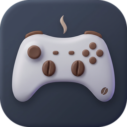
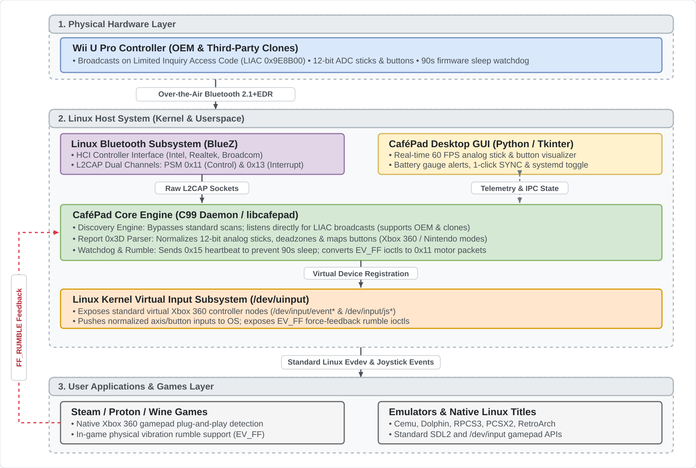
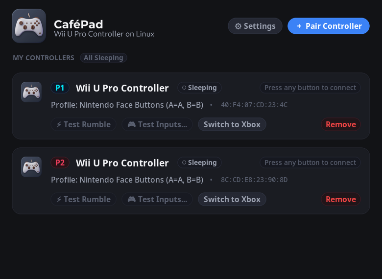
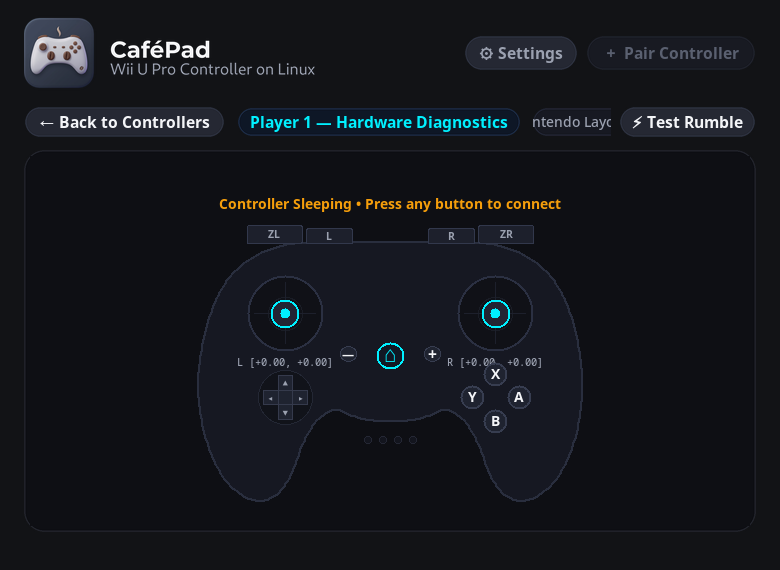
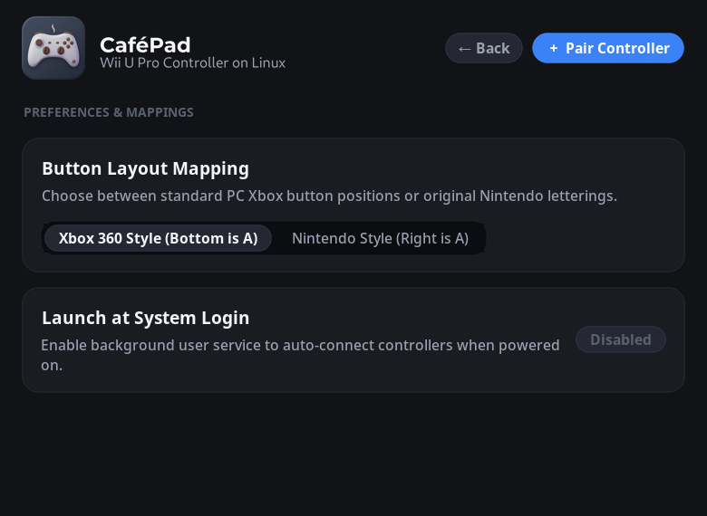
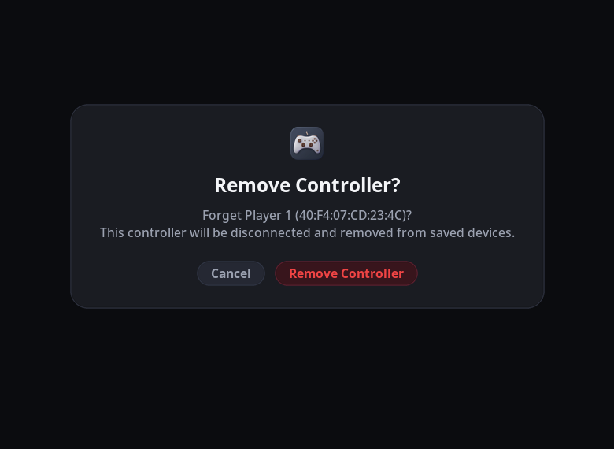

<p align="center">
  
</p>

<h1 align="center">☕ CaféPad</h1>
<p align="center"><b>Universal Linux Driver, C99 Library, and GUI Suite for Nintendo Wii U Pro Controllers</b><br/>
<i>Named in homage to the Nintendo hardware code name: <b>Project Café</b></i></p>

<p align="center">
  <a href="https://kernel.org"></a>
  <a href="LICENSE"></a>
</p>

---

## Purpose

The Nintendo Wii U Pro Controller has an 80-hour battery life and high build quality.
Many players want to use this controller for computer games and emulators on Linux.

Standard Linux distributions have connection problems with this controller:
1. **Hidden from standard Bluetooth scans:** Standard Bluetooth software searches with the General Inquiry Access Code (GIAC, `0x9E8B33`). The Wii U Pro Controller transmits only with the Limited Inquiry Access Code (LIAC, `0x9E8B00`).
2. **Third-party replica problems:** Many replica controllers do not have standard Nintendo vendor IDs or SDP records. Because of this, the Linux kernel and BlueZ reject them.
3. **The 90-second sleep timeout:** An internal watchdog timer turns off the controller after 60 to 90 seconds without communication.
4. **Missing force feedback and player LEDs:** Standard drivers do not support rumble effects (`EV_FF`) or player LED assignments.

CaféPad solves these problems with a dedicated C userspace daemon and a graphical user interface (GUI).

---

## Features

* **No external adapters:** The software connects directly through the internal Bluetooth adapter of your computer. You do not need USB adapters.
* **Universal detection:** The software finds and connects genuine Nintendo controllers and third-party replica controllers.
* **Four-player local multiplayer:** The software provides four separate worker threads. Each player slot controls its hardware LED bitmask (`0x10`, `0x20`, `0x40`, `0x80`).
* **Force feedback (rumble):** The software converts kernel `/dev/uinput` force-feedback commands (`EV_FF` / `FF_RUMBLE`) from games into controller motor vibration.
* **Desktop GUI (`cafepad-gui`):** A graphical interface lets you calibrate analog sticks, test buttons, monitor battery levels, pair controllers, and test vibration.
* **Low battery alerts:** The system sends desktop notifications (`notify-send`) when the battery level drops to 25 percent or lower.
* **Virtual Xbox 360 controller:** The software creates standard `/dev/input/js*` and `/dev/input/event*` devices with zero deadzones.
* **Active watchdog signal:** The daemon sends periodic status requests (`0x15`) to prevent the 90-second sleep timeout.
* **Portable C99 core:** A self-contained POSIX C99 library (`include/cafepad.h` and `src/cafepad.c`) operates on Linux, Android NDK, and embedded platforms.

---

## How It Works

### High-Level Summary
CaféPad is a userspace bridge between the Nintendo Bluetooth protocol and the standard Linux input subsystem:

1. **Discovery and connection:** The daemon scans for the Limited Inquiry Access Code (**LIAC**). When you start SYNC mode, the daemon opens two raw **L2CAP sockets** to the controller.
2. **Signal decoding and translation:** The software decodes 12-bit analog stick values and button bitmasks. Then, it sends standard Linux input events to `/dev/uinput` as a virtual Xbox 360 controller.
3. **Bidirectional force feedback (rumble):** The software receives `EV_FF` / `FF_RUMBLE` events from the kernel. Then, it transmits motor commands to the controller over Bluetooth.
4. **Hardware keepalive:** The software sends periodic status requests to keep the controller active.
5. **Desktop management:** A desktop GUI communicates with the daemon to show real-time stick calibration, battery levels, and player assignments.

---

### System Architecture and Data Flow

<p align="center">
  
</p>

---

### Detailed Subsystems

#### 1. Discovery and Connection Negotiation
Standard Linux Bluetooth managers search only for devices that use the General Inquiry Access Code (**GIAC**, `0x9E8B33`).
The Wii U Pro Controller transmits only with the Limited Inquiry Access Code (**LIAC**, `0x9E8B00`) when you push the SYNC button.

* CaféPad uses low-level BlueZ inquiry routines with the LIAC filter to detect controllers immediately.
* Many replica controllers do not use Nintendo vendor or product IDs (`0x057e` / `0x0330`). Instead, they show generic chipsets (for example, `0x0471` / `0x0666`).
* CaféPad checks the Bluetooth Class of Device (`0x002504` - Gamepad) and SDP service records. This check lets the software pair genuine controllers and replica controllers automatically.
* After discovery, CaféPad opens two dedicated L2CAP channels:
  * **PSM `0x11`** (HID Control) to send commands and rumble signals.
  * **PSM `0x13`** (HID Interrupt) to receive input reports at high frequency.

#### 2. Input Report Decoding and Normalization
The controller transmits data with **Report `0x3D`** in an 11-byte continuous stream.

* **Analog sticks:** The controller encodes stick positions as 12-bit values (range 0 to 4095). CaféPad normalizes these values with a calibrated center baseline (`2048`) and dynamic limits. The software converts these readings into standard Linux axis events (`ABS_X`, `ABS_Y`, `ABS_RX`, `ABS_RY`).
* **Button mapping:** CaféPad decodes button states from raw bitmasks. You can select between two layouts:
  * **Xbox 360 layout (default):** Maps buttons by physical position. The bottom button sends `BTN_SOUTH` (Xbox A). The right button sends `BTN_EAST` (Xbox B). This layout matches modern PC game prompts.
  * **Nintendo native layout:** Maps buttons by printed label. The physical button A sends `BTN_EAST`. The physical button B sends `BTN_SOUTH`.

#### 3. Virtual Input Subsystem (`/dev/uinput`)
CaféPad registers a virtual hardware device with the Linux kernel through `/dev/uinput`.

* Games interact with the virtual gamepad through `/dev/input/event*` and `/dev/input/js*`.
* The virtual gamepad exposes standard Xbox 360 capabilities.
* Steam Input, Wine, Proton, and native Linux games recognize the controller without manual configuration.

#### 4. Force Feedback (Rumble) Engine
CaféPad provides full rumble support for games:

* The daemon registers `EV_FF` and `FF_RUMBLE` capabilities on the virtual uinput device.
* When a game sends a rumble effect, the Linux kernel forwards the `FF_RUMBLE` request to CaféPad.
* The daemon calculates the motor vibration level.
* The daemon creates an output **Report `0x11`** with the rumble flag.
* The daemon sends this report over L2CAP PSM `0x11` to the controller immediately.

#### 5. Watchdog Keepalive and Power Management
The firmware of the Wii U Pro Controller includes an internal sleep timer.
If the host does not send communication within 60 to 90 seconds, the controller disconnects.

* CaféPad runs an asynchronous timer that sends periodic status requests (**Report `0x15`**).
* This signal keeps the controller active during gameplay.
* The status response also gives continuous battery level data to the daemon.

#### 6. Desktop GUI and Telemetry
The desktop application (`cafepad-gui`) is written in Python and Tkinter:

* It reads configuration files and telemetry data from `~/.config/cafepad.json`.
* It provides a 60 frames-per-second visual display for stick deflection, button presses, and battery levels.
* It lets you test controller vibration with one click.
* It configures systemd autostart services without manual terminal commands.

---

## Quick Start

### 1. Install the Software
Clone the repository and run the installation script:

```bash
git clone https://github.com/enricopro/cafepad.git
cd cafepad
./install.sh
```

### 2. Connect the Controller
1. Turn on the controller.
2. Push and hold the red **SYNC** button on the back of the controller until the four LEDs flash rapidly.
3. Start CaféPad in your terminal:
   ```bash
   cafepad
   ```
   *Note: You can also start the graphical interface with `cafepad-gui`.*
4. The controller vibrates, and the Player 1 LED stays on. The gamepad is now ready for use.

> [!TIP]
> CaféPad saves the Bluetooth MAC address to `~/.config/cafepad.json`. For later connections, push any button on the controller to connect automatically.

---

## Desktop GUI (`cafepad-gui`)

CaféPad includes a graphical desktop application for configuration and hardware tests:

<p align="center">
  
  
</p>
<p align="center">
  
  
</p>

Start the desktop interface:
```bash
cafepad-gui
```
*Note: You can also start the interface from your desktop application menu.*

### Main GUI Functions
* **Four-player status cards:** Show connection states, MAC addresses, and battery levels.
* **Diagnostics screen:** Shows analog stick positions, trigger values, and button presses at 60 frames per second.
* **Sync assistant:** Click **"Pair Controller"** and push the SYNC button. The GUI pairs the controller and assigns an available player slot.
* **Rumble test:** Tests the vibration motors with one click.
* **Layout switch:** Switches between **Xbox 360 Mode** and **Nintendo Native Mode**.
* **Systemd control:** Enables or disables automatic startup at user login.
* **Confirmation dialogs:** Confirms controller disconnection or removal.

---

## Background Service (systemd)

You can run CaféPad as a user service.
This service lets controllers connect automatically when you push any button:

```bash
systemctl --user enable --now cafepad
```

To view live service logs, run:
```bash
journalctl --user -u cafepad -f
```

---

## Controller Layout and Mapping

By default, CaféPad maps buttons by **physical position** (Xbox 360 layout).
This mapping gives standard compatibility with Steam and modern PC games:

| Wii U Pro Label | Physical Position | Linux Evdev Button | Xbox 360 Equivalent |
|:---:|:---:|:---:|:---:|
| **B** | Bottom | `BTN_SOUTH` (`0x130`) | **A** |
| **A** | Right | `BTN_EAST` (`0x131`) | **B** |
| **Y** | Left | `BTN_NORTH` (`0x133`) | **X** |
| **X** | Top | `BTN_WEST` (`0x134`) | **Y** |
| **L** / **R** | Shoulders | `BTN_TL` / `BTN_TR` | **LB** / **RB** |
| **ZL** / **ZR** | Triggers | `ABS_Z` / `ABS_RZ` | **LT** / **RT** |
| **-** / **+** | Center | `BTN_SELECT` / `BTN_START` | **Back** / **Start** |
| **HOME** | Center Guide | `BTN_MODE` (`0x13c`) | **Xbox / Guide** |
| **L3** / **R3** | Stick Clicks | `BTN_THUMBL` / `BTN_THUMBR` | **L3** / **R3** |
| **D-Pad** | Directional | `ABS_HAT0X` / `ABS_HAT0Y` | **Hat Switch** |

> [!NOTE]
> To map buttons by printed letter (A to A, B to B), use the `--nintendo-layout` option or change the setting in the GUI:
> ```bash
> cafepad --nintendo-layout
> ```

---

## Command-Line Interface (CLI) Reference

```text
Usage: cafepad [OPTIONS]

Options:
  -h, --help            Show this help text and exit
  --target, --mac MAC   Connect directly to a specified Bluetooth MAC address
  --scan, --pair        Scan for controllers in SYNC mode
  --test-rumble         Test vibration motors on the connected controller
  --nintendo-layout     Map buttons by printed letters (A to A)
  --gui                 Start the graphical desktop interface
  --status              Show configured controller slots and exit
  --daemon              Run as a background daemon (for systemd)
  -v, --version         Show version information and exit
```

---

## C API (`libcafepad`)

CaféPad includes a POSIX C99 library (`libcafepad.so` and `libcafepad.a`).

### Example Code
Save this code as `example.c`:

```c
#include <stdio.h>
#include <unistd.h>
#include <cafepad.h>

int main(void) {
    /* Opens a saved Bluetooth controller, USB device, or /dev/input/js* */
    cafepad_device_t* dev = cafepad_open();
    if (!dev) {
        printf("Controller not found. Put controller in SYNC mode and retry.\n");
        return 1;
    }

    printf("Connected. Polling inputs...\n");
    cafepad_state_t state;

    while (1) {
        if (cafepad_poll(dev, &state, 10) > 0) {
            printf("\rL-Stick: [%+0.2f, %+0.2f]  R-Stick: [%+0.2f, %+0.2f]  Btns: 0x%05X  Bat: %d  ",
                   state.left_stick.x, state.left_stick.y,
                   state.right_stick.x, state.right_stick.y,
                   state.buttons, state.battery_level);
            fflush(stdout);
        }
    }

    cafepad_close(dev);
    return 0;
}
```

### Compile the Example
Compile the program with `pkg-config`:

```bash
gcc example.c $(pkg-config --cflags --libs cafepad) -o example
./example
```

---

## Portability and Embedded Platforms

CaféPad can operate on platforms other than desktop Linux:

* **Self-contained C99 implementation:** The core source files ([`src/cafepad.c`](src/cafepad.c) and [`include/cafepad.h`](include/cafepad.h)) do not depend on Python or desktop libraries.
* **Android NDK compatibility:** The packet parser and L2CAP routines compile with the Android Bionic C library and NDK. You can embed the library into Android TV applications or RetroArch drivers.
* **Dual interface support:** The software supports wireless Bluetooth L2CAP connections and wired USB replica controllers (`0471:0666`).

---

## Backwards Compatibility

CaféPad maintains compatibility for scripts and build environments configured for `wiiupro`:

* The `wiiupro` command links directly to `cafepad`.
* The header `<wiiupro.h>` includes `<cafepad.h>` and provides aliases for all types and constants.
* The installation provides `libwiiupro.so`, `libwiiupro.a`, and `wiiupro.pc`.

---

## Uninstallation

To remove udev rules, binary files, libraries, and desktop menu entries, run:

```bash
./uninstall.sh
```

---

## License

This project uses the **GNU General Public License v3.0** (GPL-3.0). Refer to [LICENSE](LICENSE) for the complete license text.
