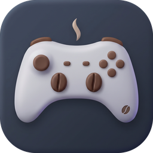
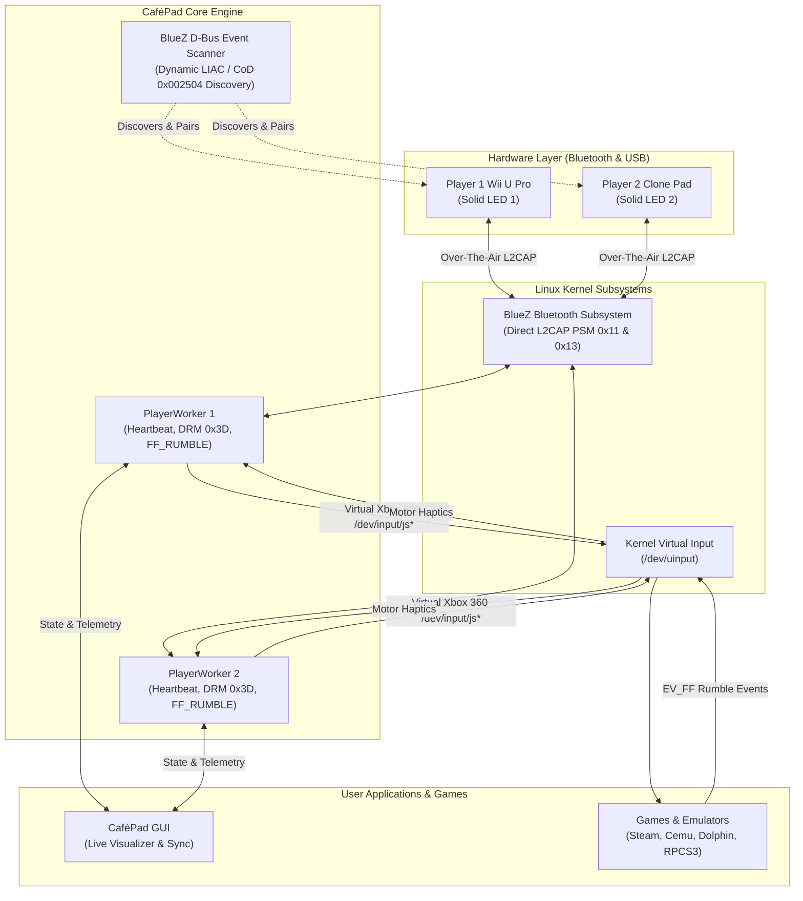
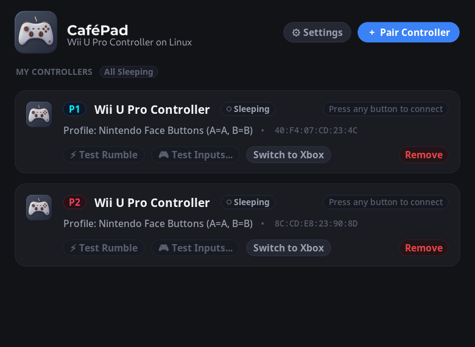
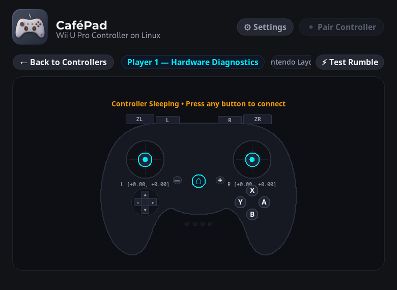
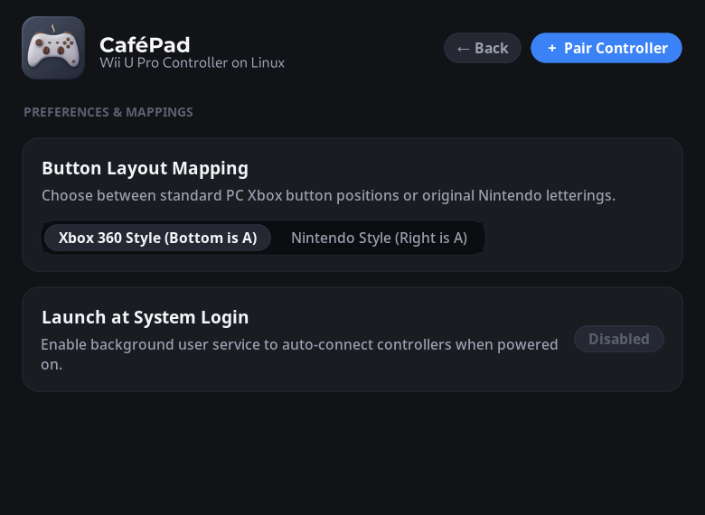
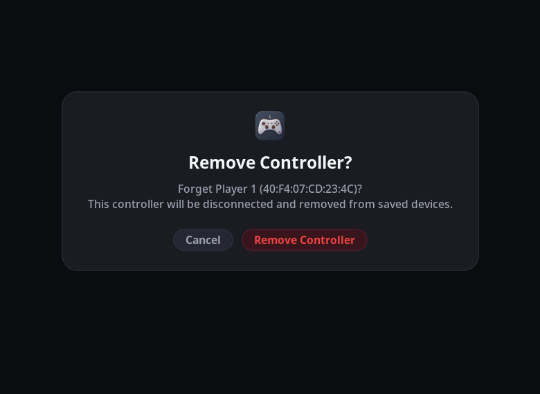

<p align="center">
  
</p>

<h1 align="center">☕ CaféPad</h1>
<p align="center"><b>Universal Linux Driver, C99 Library & GUI Suite for Nintendo Wii U Pro Controllers</b><br/>
<i>Named in homage to Nintendo's internal Wii U hardware codename: <b>Project Café</b></i></p>

<p align="center">
  <a href="https://kernel.org"></a>
  <a href="https://bluez.org"></a>
  
  
  
  <a href="https://python.org"></a>
  
  <a href="LICENSE"></a>
</p>

---

## 🌟 Why CaféPad?

The **Nintendo Wii U Pro Controller** remains one of the finest gamepads ever built: outstanding ergonomics, symmetrical analog sticks, responsive D-Pad, and a legendary **80-hour battery life**.

However, using it on modern Linux distributions has historically been frustrating:
1. **Hidden from standard Bluetooth scans:** Standard Bluetooth utilities search only via GIAC (`0x9E8B33`). The Wii U Pro Controller broadcasts exclusively on **LIAC** (*Limited Inquiry Access Code*, `0x9E8B00`).
2. **Broken third-party replicas:** Millions of replica and clone controllers lack Nintendo vendor IDs or SDP records, causing kernel `hid-wiimote` and BlueZ plugins to reject them.
3. **The 90-Second Freeze:** Unattended controllers sleep mid-game due to an internal microcode power-saving watchdog.
4. **Lack of Force Feedback (Rumble) & Multi-Controller LEDs:** Standard tools lacked game rumble (`EV_FF`) or multi-controller player LED indicators.

**CaféPad solves all of this out of the box.**

---

## ✨ Features at a Glance

* 🚀 **Zero External Dongles:** Pairs directly through your PC or laptop's built-in Bluetooth adapter (Intel, Realtek, Broadcom, Qualcomm, etc.). No Mayflash or 8BitDo adapters needed.
* 🛡️ **Universal Dynamic Detection:** Flawlessly pairs both **genuine Nintendo** controllers and **third-party clones** (including VID `0471` / PID `0666` and unbranded replicas) using over-the-air BlueZ discovery. Zero hardcoded MAC addresses.
* 👥 **4-Player Local Multiplayer:** Independent worker threads for Players 1 to 4 with respective hardware LED bitmasks (`0x10`, `0x20`, `0x40`, `0x80`).
* ⚡ **In-Game Force Feedback (Rumble):** Implements Linux kernel `/dev/uinput` `EV_FF` / `FF_RUMBLE` ioctls. Explosions, collisions, and haptic cues in Steam, Cemu, and retro emulators translate directly into physical motor rumble.
* 🖥️ **Desktop GUI (`cafepad-gui`):** Sleek dark-mode interface featuring real-time stick crosshairs, button diagnostic highlights, battery gauges, one-click over-the-air syncing, and vibration testing.
* 🔋 **Low-Battery Desktop Alerts:** Automatically notifies you via desktop toast (`notify-send`) when battery drops to $\le 1$ bar so you never lose control mid-boss fight.
* 🎯 **Virtual Xbox 360 Emulation:** Exposes controllers system-wide as standard `/dev/input/js*` and `/dev/input/event*` devices with zero deadzones.
* ⏱️ **Active Watchdog Heartbeat:** Continual keepalive status requests (`0x15`) prevent the 90-second microcode freeze.
* 📺 **Portable C99 Core for Android TV / Google TV:** Clean, self-contained POSIX C99 library (`include/cafepad.h` and `src/cafepad.c`) designed for Android NDK, RetroArch cores, and embedded TV appliances.

---

## 🏛️ Architecture Overview



---

## ⚡ 1-Minute Quick Start

### 1. Install (One-Step Script)
Clone the repository and run the automated universal installer:

```bash
git clone https://github.com/yourusername/cafepad.git
cd cafepad
./install.sh
```

### 2. Connect Your Controller
1. Turn on your controller and **press and hold the RED SYNC BUTTON** on the back until the 4 blue LEDs at the bottom start flashing rapidly.
2. Run CaféPad in your terminal:
   ```bash
   cafepad
   ```
   *(Or launch the graphical interface with `cafepad-gui`)*
3. The controller vibrates, Player 1 LED locks solid blue, and your gamepad is ready system-wide!

> [!TIP]
> The controller's MAC address is automatically saved to `~/.config/cafepad.json`. On subsequent uses, simply press any button on your controller to connect in under 1 second!

---

## 🖥️ Graphical Desktop Interface (`cafepad-gui`)

CaféPad includes a dedicated, dark-mode desktop application built with continuous curvature and modern typography:

<p align="center">
  
  
</p>
<p align="center">
  
  
</p>

```bash
cafepad-gui
```

*(You can also launch it directly from your desktop application launcher like GNOME Dash or KDE Kickoff)*

### Key GUI Capabilities:
* **4-Player Hardware Cards:** View connection states, MAC addresses, and battery indicators with controller squircle glyphs.
* **Authentic Wii U Symmetrical Diagnostics:** High-speed 60 FPS visualizer showing analog sticks in authentic Wii U top positions, triggers, and ABXY diamond.
* **One-Click Sync Wizard:** Click **"Pair Controller"** and hold the red SYNC button; the GUI automatically pairs and registers the pad to the next available player slot.
* **Haptic Rumble Testing:** One-click vibration motor test button.
* **Layout Switcher:** Instantly toggle between **Xbox 360 Mode** (standard PC gaming) and **Nintendo Native Mode** (A=A, B=B).
* **Systemd Integration:** Enable or disable background login autostart with a single click.
* **In-Window Modal Confirmations:** Elegant confirmation sheets for disconnecting and forgetting saved controllers.

---

## 🔄 Automatic Background Service (Systemd)

If you want your controllers to connect automatically whenever you press any button—without ever needing to open a terminal:

```bash
systemctl --user enable --now cafepad
```

To view live service output:
```bash
journalctl --user -u cafepad -f
```

---

## 🎮 Controller Layout & Button Mapping

By default, buttons are mapped by **physical position** (Xbox 360 layout) for seamless compatibility with Steam and modern games:

| Wii U Pro Label | Physical Position | Linux Evdev Button | Xbox 360 Equivalent |
|:---:|:---:|:---:|:---:|
| **B** | Bottom | `BTN_SOUTH` (`0x130`) | **A** |
| **A** | Right | `BTN_EAST` (`0x131`) | **B** |
| **Y** | Left | `BTN_NORTH` (`0x133`) | **X** |
| **X** | Top | `BTN_WEST` (`0x134`) | **Y** |
| **L** / **R** | Shoulders | `BTN_TL` / `BTN_TR` | **LB** / **RB** |
| **ZL** / **ZR** | Triggers | `ABS_Z` / `ABS_RZ` | **LT** / **RT** |
| **-** / **+** | Center | `BTN_SELECT` / `BTN_START` | **Back** / **Start** |
| **HOME** | Center Guide | `BTN_MODE` (`0x13c`) | **Xbox / Guide** |
| **L3** / **R3** | Stick Clicks | `BTN_THUMBL` / `BTN_THUMBR` | **L3** / **R3** |
| **D-Pad** | Directional | `ABS_HAT0X` / `ABS_HAT0Y` | **Hat Switch** |

> [!NOTE]
> Want printed letter matching (A maps to A, B maps to B)? Pass the flag:
> ```bash
> cafepad --nintendo-layout
> ```

---

## 🛠️ Command-Line Interface Reference

```text
Usage: cafepad [OPTIONS]

Options:
  -h, --help            Show help message and exit
  --target, --mac MAC   Connect directly to a specific Bluetooth MAC address
  --scan, --pair        Force inquiry scan for nearby controllers in SYNC mode
  --test-rumble         Test physical vibration motors on connected controller
  --nintendo-layout     Map buttons by printed letters (A->A) instead of Xbox positions
  --gui                 Launch CaféPad graphical desktop interface
  --status              Print configured controller slots and exit
  --daemon              Run silently in background (for systemd service)
  -v, --version         Print version information
```

---

## 💻 Developer API: C99 Library (`libcafepad`)

CaféPad includes a clean, high-performance C library (`libcafepad.so` and `libcafepad.a`) with complete POSIX compatibility:

### Minimal C Example
Save as `example.c`:
```c
#include <stdio.h>
#include <unistd.h>
#include <cafepad.h>

int main(void) {
    /* Automatically opens saved Bluetooth controller, USB, or /dev/input/js* */
    cafepad_device_t* dev = cafepad_open();
    if (!dev) {
        printf("Controller not found. Put controller in SYNC mode and retry.\n");
        return 1;
    }

    printf("Connected! Polling inputs...\n");
    cafepad_state_t state;

    while (1) {
        if (cafepad_poll(dev, &state, 10) > 0) {
            printf("\rL-Stick: [%+0.2f, %+0.2f]  R-Stick: [%+0.2f, %+0.2f]  Btns: 0x%05X  Bat: %d  ",
                   state.left_stick.x, state.left_stick.y,
                   state.right_stick.x, state.right_stick.y,
                   state.buttons, state.battery_level);
            fflush(stdout);
        }
    }

    cafepad_close(dev);
    return 0;
}
```

### Compiling with pkg-config:
```bash
gcc example.c $(pkg-config --cflags --libs cafepad) -o example
./example
```

---

## 📺 Portability & Android TV / Google TV Applications

CaféPad was designed from the ground up to be portable beyond traditional Linux desktop distributions:
* **Self-Contained C99 Implementation:** [`src/cafepad.c`](src/cafepad.c) and [`include/cafepad.h`](include/cafepad.h) do not depend on external Python or desktop runtime libraries.
* **Android NDK Compatibility:** The packet parser and L2CAP sequencing compile cleanly under Android's Bionic libc / NDK, making it directly embeddable into Android TV / Google TV native apps or RetroArch input drivers.
* **USB & Bluetooth Dual Engine:** Supports both wireless over-the-air Bluetooth L2CAP and wired USB clone protocols (`0471:0666`).

---

## 🔄 Backwards Compatibility

If you have existing scripts or build workflows configured for `wiiupro`:
* The executable command `wiiupro` is symlinked to `cafepad`.
* The header `<wiiupro.h>` automatically includes `<cafepad.h>` and provides aliases for all types and constants.
* `libwiiupro.so`, `libwiiupro.a`, and `wiiupro.pc` are provided out of the box.

---

## 🧹 Uninstallation

To cleanly remove udev rules, binaries, libraries, and desktop entries:

```bash
./uninstall.sh
```

---

## 📜 License

Distributed under the **MIT License**. Free for personal, educational, and commercial game integration.
